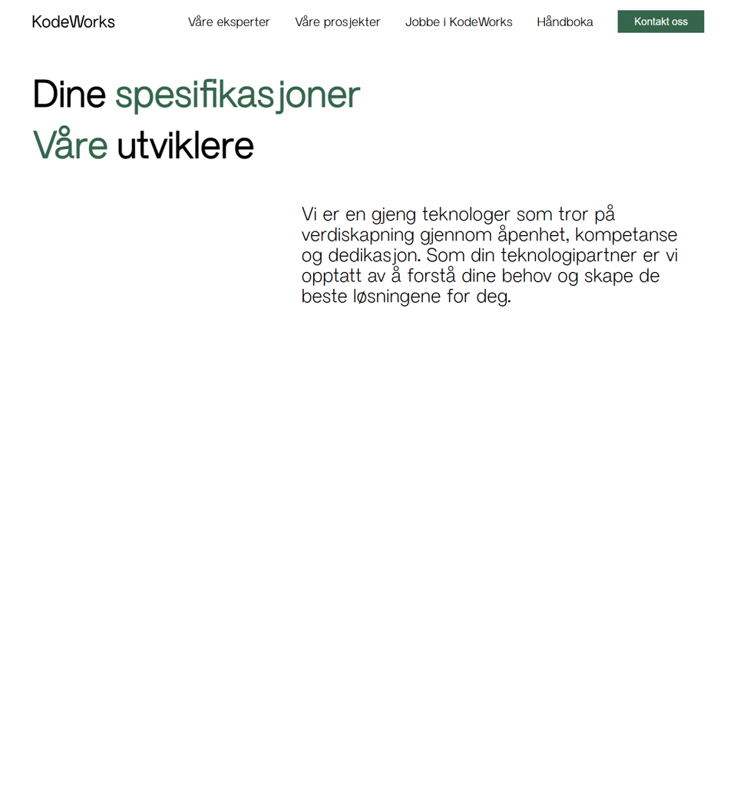
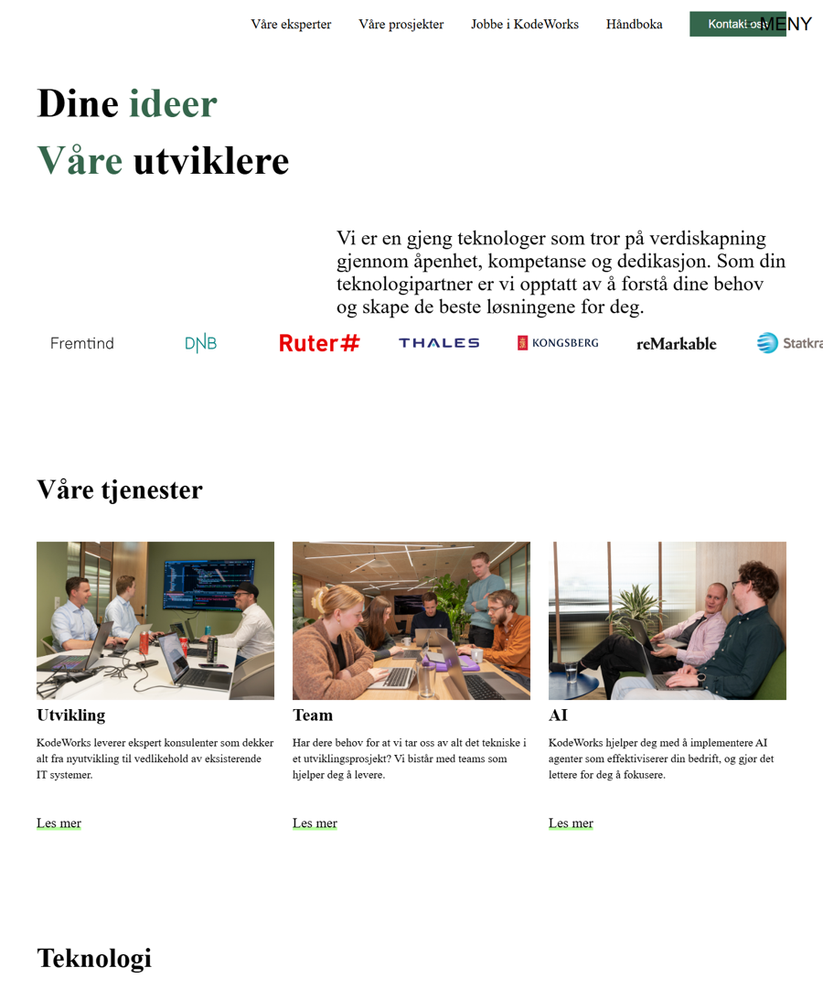
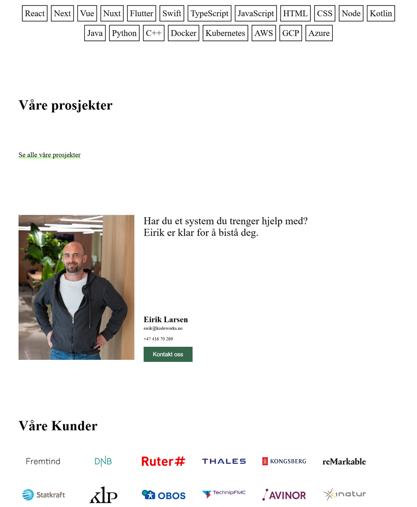
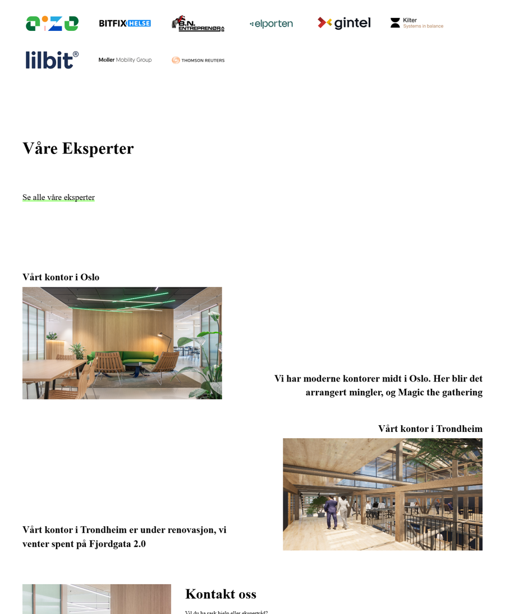
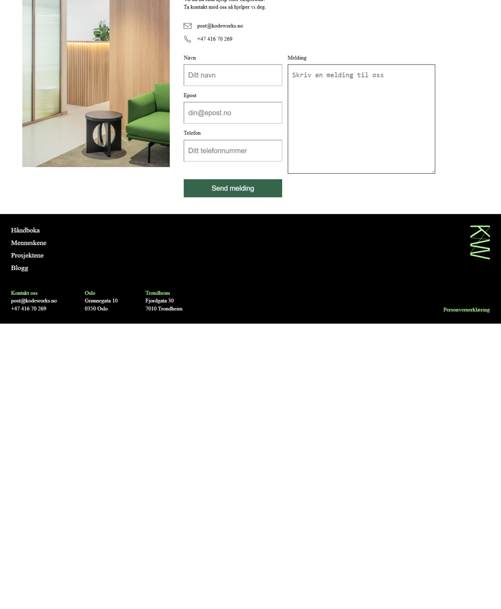

# Designet på kodeworks.no (kartlagt 2026-11-11)

Kartlegging av det visuelle uttrykket på KodeWorks' nåværende nettside, som er det mest oppdaterte uttrykket profilen har i praksis. Fargeverdier, fonter og størrelser er hentet direkte fra nettsidens CSS (Next.js-stilark); helhetsinntrykket fra skjermbilder av forsiden tatt med Edge i hodeløs modus.

Skjermbilder i `2026-11-11_kodeworks_no_design_media/`:

| | |
|:---:|:---:|
|  |  |
| *Toppen av forsiden med riktig font* | *Topp, kunderekke og tjenester* |
|  |  |
| *Teknologi, prosjekter, kontaktperson, kunder* | *Kunder, eksperter, kontorene* |
|  | |
| *Kontaktskjema og bunntekst* | |

Merk: Skjermbildene del 1–4 er tatt av en lokal kopi der animasjoner er slått av for at alt innhold skal vises; der er webfonten erstattet av en standard seriffont. Fonten på nettsiden er Non Natural Grotesk, som i bildet «Toppen av forsiden med riktig font».

## Farger

Definert som CSS-variabler på nettsiden:

| Variabel | Verdi | Bruk på nettsiden |
|---|---|---|
| `--color-green` | `#B6FF9E` | Den mest brukte fargen i stilarket (22 forekomster): understrek på lenker («Les mer», «Se alle …»), etiketter i bunnteksten («Kontakt oss», «Oslo», «Trondheim»), KW-symbolet i bunnteksten, venstrekant på sitater (10 px), menylinje i «grønn modus». Brukes som aksent, nesten aldri som stor flate. |
| `--color-new-green` | `#35664C` | Knapper («Kontakt oss», «Send melding»), uthevede ord i toppteksten («ideer», «Våre»). Den synlige hovedfargen for interaktive elementer. |
| `--color-new-green-dark` | `#254333` | Brukt én gang i stilarket (mørk variant). |
| `--color-new-pink` | `#FAD5D5` | Bakgrunn for den rullende kunderekka (logo-reel), klassen `pink-text`. |
| `--color-grey` | `#E8E7E6` | Lite brukt (3 forekomster). |
| `--color-dark-grey` | `#666` | Sekundærtekst. |
| — | `#000` / `#FFF` | Svart tekst på hvit bakgrunn er grunnflaten. Bunnteksten er svart med hvit tekst. |

Prefikset «new» i variabelnavnene tyder på at mørkegrønn og rosa er bevisst lagt til etter 2021-profilen, som bare har grønn `#B6FF9E`, grå `#E8E7E6`, svart og hvit. Tidligere kartlegging (ITKO-presentasjonen, september 2026) fant også nesten-svart `#0F1613` som mørk bakgrunn.

## Typografi

- **Font:** Non Natural Grotesk, lastet som webfont i to vekter: Regular (`Natural Grotesk`) og Light (`Natural Grotesk Light`).
- **Brødtekst og overskrifter:** Light er standard for alt (`body`, `h1`–`h6`, `p`). Linjeavstand 1,4 i brødtekst.
- **Størrelser:** Hovedtittel 3rem (48 px) med linjeavstand 1 og ordvis animasjon («Dine *ideer* / *Våre* utviklere», der annethvert ord er mørkegrønt); seksjonstitler 3rem; ingresstekst 1,25rem (20 px) med linjeavstand 1,625; tjenestetitler `text-3xl` (30 px); øvrige vanlige størrelser 14, 16, 18, 20, 22, 24, 28, 32, 40 og 42 px.
- **Uttrykk:** Store, luftige titler i lett vekt; lite bruk av fet skrift.

## Layout og grid

- Maks bredde 1400 px (smal variant 1100 px); gutter 30 px (mobil 20 px); vertikale mellomrom 60 px (medium) og 120 px (stor).
- Mye hvitt rom. Venstrejusterte titler; ingressen står forskjøvet mot høyre i toppseksjonen.
- Seksjonsrekkefølge på forsiden: topp med tittel og ingress → rullende kunderekke → «Våre tjenester» (tre kort: Utvikling, Team, AI, hvert med foto, tittel, kort tekst, «Les mer») → «Teknologi» (teknologinavn i omrissede bokser) → «Våre prosjekter» → kontaktperson med foto, navn, e-post, telefon og knapp → «Våre Kunder» (logorutenett) → «Våre Eksperter» → kontorene i Oslo og Trondheim (foto og tekst vekselvis venstre/høyre) → kontaktskjema → bunntekst.

## Komponenter

- **Toppmeny:** Navnetrekket «KodeWorks» til venstre; lenker «Våre eksperter», «Våre prosjekter», «Jobbe i KodeWorks», «Håndboka»; knapp «Kontakt oss» i mørkegrønn til høyre.
- **Knapper:** Mørkegrønn `#35664C` flate, hvit tekst, ingen avrunding (rektangulære), 1,25rem tekst.
- **Lenker:** Svart tekst med lysegrønn `#B6FF9E` understrek.
- **Teknologibokser:** Tynn svart ramme, ingen fyll.
- **Skjemafelt:** Tynn svart ramme (1,25 px), luftig innvendig marg.
- **Bunntekst:** Svart bakgrunn, hvit tekst, lysegrønne etiketter, KW-symbolet i lysegrønn strek øverst til høyre; kontaktinfo og adresser i tre kolonner.

## Bildebruk

- Ekte fotografier av ansatte og kontorene: varme toner, tre, planter, dagslys, mennesker i arbeid. Ingen illustrasjoner eller stockfoto-preg.
- Kundelogoer i originalfarger på lys bakgrunn.
- Det femte elementet / seismografen fra 2021-profilen er ikke synlig på forsiden; KW-symbolet brukes bare i bunnteksten.

## Sammenligning med 2021-profilen (stikkord til revisjonen)

| Element | 2021-profilen | Nettsiden nå |
|---|---|---|
| Hovedgrønn | `#B6FF9E` som hovedfarge, også store flater | `#B6FF9E` som aksent; mørkegrønn `#35664C` på knapper og uthevinger |
| Grå | `#E8E7E6` som hovedfarge | Nesten ikke brukt; hvit dominerer |
| Nye farger | — | Mørkegrønn `#35664C` / `#254333`, rosa `#FAD5D5` |
| Font | Non Natural Grotesk | Samme, i Light og Regular; Light som standard |
| Det femte elementet | Sentralt grafisk element | Ikke synlig på forsiden |
| Bilder | Moodboard-preg, interiør | Ekte foto av ansatte og kontor |
