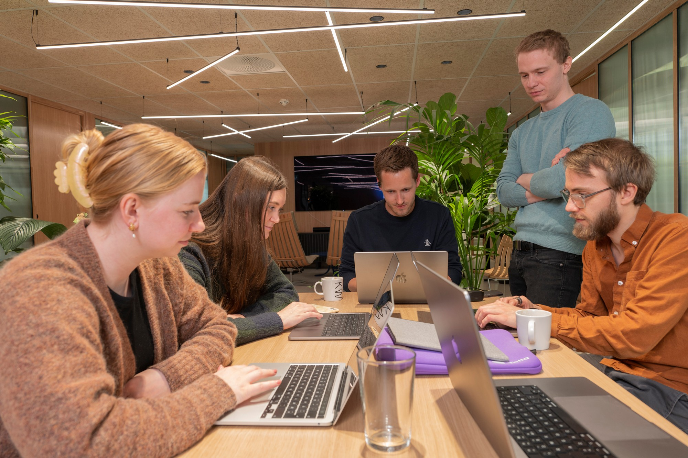
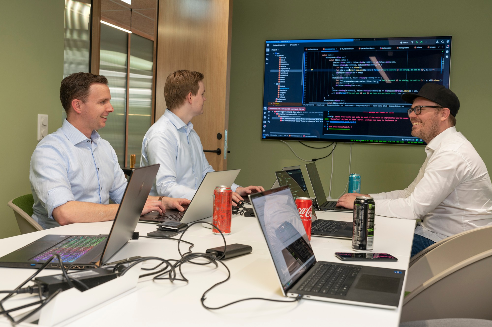

::: notes
Hils og si kort hvem vi er. Poenget med presentasjonen er å vise hvordan vi jobber og hva vi har levert, slik at dere kan vurdere om vi passer til det dere skal bygge.
:::

# Hvem vi *er* {number="01"}

En gruppe teknologer med kontor i Trondheim og Oslo.

::: notes
Første del: selskapet, tjenestene og tallene.
:::

## Vi muliggjør *ideer*

KodeWorks er en teknologipartner. Vi forstår behovet først, og leverer deretter løsningen.

- **Utvikling:** enkeltkonsulenter til nye prosjekter og til vedlikehold av eksisterende systemer
- **Team:** komplette leveranseteam med prosjektledelse og teknisk gjennomføring
- **AI-løsninger:** AI-agenter som effektiviserer forretningsprosesser

::: notes
Visjonen vår er «Vi muliggjør ideer». Tre måter å jobbe med oss på: enkeltkonsulent, team eller AI-løsninger. Ambisjonen er alltid at dere selv skal kunne drive videre.
:::

## En gruppe *teknologer* {.image}

Vi tror på verdiskaping gjennom åpenhet, kompetanse og engasjement.

Vi har tatt produkter fra idéstadiet og ut i markedet siden 2008, både for kunder og for oss selv.

KodeWorks AS ble kåret til Gaselle-bedrift i 2023.

::: notes
Vi har både feilet og lykkes, og vet hva som skal til. Mange av oss har erfaring fra egne oppstartsselskaper, og det preger måten vi jobber på.
:::

## KodeWorks i *tall* {.figures}

2008
: Året KodeWorks ble etablert

27
: Utviklere

39,7
: MNOK i omsetning, 2023

::: notes
Tallene er fra selskapets presentasjon fra 2023: etablert 2008, 27 utviklere og 39,7 millioner kroner i omsetning i 2023. Oppdater tallene før utsending hvis presentasjonen brukes senere.
:::

# Slik *jobber* vi {number="02"}

Vi tilpasser oss prosjektets fase, og er med så lenge vi bidrar.

::: notes
Andre del: arbeidsmåten.
:::

## Fra *idé* til drift

:::: columns
::: column
### Tidlig fase

- Prototyp og MVP rundt forretningsmilepæler
- Utviklingsstrategi
- Erfaring med offentlige støtteordninger
:::
::: column
### Etablert produkt

- Skalering og integrasjoner
- Vedlikehold og drift av kritiske systemer
- Opplæring og handover
:::
::::

::: notes
Vi kan gå inn i alle faser: oppstart, videre utvikling med team og skalering av et etablert produkt. Vi tilpasser oss prosjektets tilstand og kundens eksisterende metodikk.
:::

## Det dere kan *forvente*

:::: columns
::: column
- **Faglig sterk:** dyktige og trygge teknologer
- **Åpenhet:** vi tror på transparens og oversikt
:::
::: column
- **Delingskultur:** kompetanseoverføring til deres team
- **Samskapende:** vi jobber tett og sømløst med alle involverte
:::
::::

::: notes
Dette er de fire løftene i den strategiske plattformen vår. Spør gjerne hvilke av dem som veier tyngst for dere.
:::

## {.quote}

> Vi er med så lenge vi bidrar positivt inn i prosjektet. Aldri lenger.

Kilde: KodeWorks' strategiske plattform

::: notes
Sitatet er forkortet fra plattformens ordlyd («vi er bare med så lenge …»). Dette er kjernen i hvordan vi forstår rollen vår. Vi motiveres av å skape, ikke drifte, og målet er at dere kan drive videre på egen hånd.
:::

# Utvalgte *prosjekter* {number="03"}

Erfaring fra energi, finans, maritim og teknologi.

::: notes
Tredje del: referanser. Velg de som er mest relevante for kunden.
:::

## Fra *energisektoren* {.image}

- **Statkraft:** Fusion, plattform for PPA-booking og risiko (2020–2021)
- **Equinor:** Echo 3D, digital tvilling (2022–nå)
- **SkandiaEnergi:** Elkompis, app for strømforbruk (2021–2022)
- **EnerSky:** API for energidata, i KodeWorks' egen portefølje (2024–nå)

::: notes
Fire eksempler fra energi. Statkraft og Equinor er eksterne kunder. Elkompis er en forbruker-app for iOS og Android. EnerSky er et selskap i vår egen portefølje som leverer energidata via et REST-API.
:::

## Noen av våre *kunder* {.logos}

Innen finans, energi, transport og teknologi.

- DNB
- Fremtind
- Ruter
- Statkraft
- Thales
- Kongsberg
- reMarkable
- Avinor

::: notes
Kundene er hentet fra logoveggen på kodeworks.no. Bytt ut med de som er mest relevante for mottakeren, og legg inn logoer som PDF når de er klarert for bruk.
:::

## Teknologi vi *bruker*

- **Frontend og mobil:** React, Next, Vue, Nuxt, Flutter, Swift og Kotlin
- **Språk:** TypeScript, JavaScript, Java, Python og C++
- **Infrastruktur:** Docker, Kubernetes, AWS, GCP og Azure

::: notes
Oversikten er ikke uttømmende. Vi tilpasser teknologivalget til kundens eksisterende stack.
:::

## Takk {.closing}

::: notes
Avslutt med å foreslå en første samtale om behovet deres.
:::
